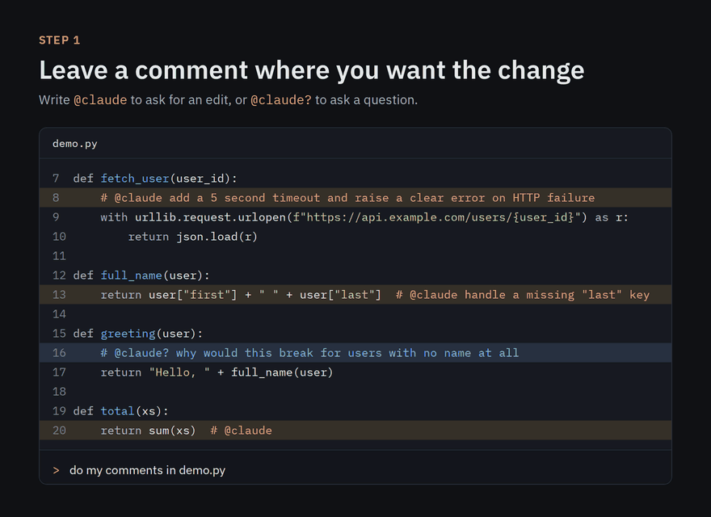
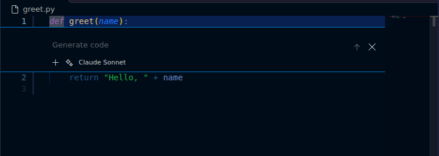

# skills

Personal [Claude Code skills](https://code.claude.com/docs/en/skills), one per directory under `skills/`.

<p align="center">
  
</p>

## Skills

| Skill | What it does |
|---|---|
| [copilot-claude](skills/copilot-claude/) | Makes GitHub Copilot's own Ctrl+I inline chat run on Claude via your Claude Code login (no API key). Installs the extension below and sets the default model. |
| [inline-comments](skills/inline-comments/) | Copilot-style "comment to change": write `@claude <instruction>` in your code, and each one becomes a separate edit you review in the IDE. |

## VS Code extension

[claude-inline](vscode/claude-inline/) puts Claude, through the Claude Code CLI login, into VS Code's
model picker, so **Copilot's own inline chat (Ctrl+I) runs on Claude**. Set it up with the
`copilot-claude` skill ("set up Copilot inline chat with Claude"), or by hand from
[Releases](https://github.com/HelgiHelgasonCMD/skills/releases).

<p align="center">
  
</p>

## Install the skills

As a Claude Code plugin (2.1.275+):

```
/plugin install helgi-skills --marketplace HelgiHelgasonCMD/skills
```

Older versions: `/plugin marketplace add HelgiHelgasonCMD/skills`, then `/plugin install helgi-skills@helgi-skills`.

## Developing

```bash
make install   # symlink skills/* into ~/.claude/skills (never overwrites anything it didn't create)
make check     # validate skills, scan for leaks, run tests
```

## Conventions

- `skills/<name>/SKILL.md` with `name` matching the directory and a `description` that says **when** to use it.
- Detail goes in `references/`, scripts in `scripts/`; keep `SKILL.md` under 500 lines.
- Anything environment-specific (tenants, org names, internal hosts) goes in a gitignored
  `references/*.local.md` that the skill reads if present. The public skill stays generic.
- `tools/scan_sensitive.py` blocks commits containing GUIDs, emails, Azure DevOps org URLs,
  or any term in the local, gitignored `.sensitive-terms.local`.

Enable the pre-commit hook after cloning: `git config core.hooksPath .githooks`.
