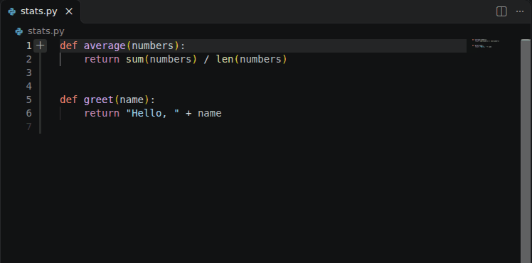
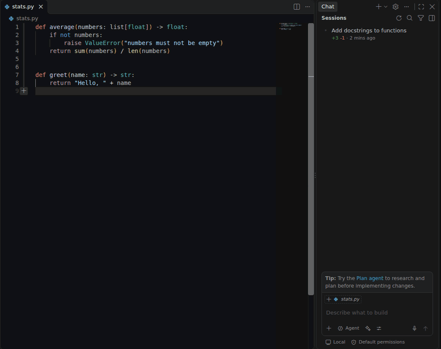
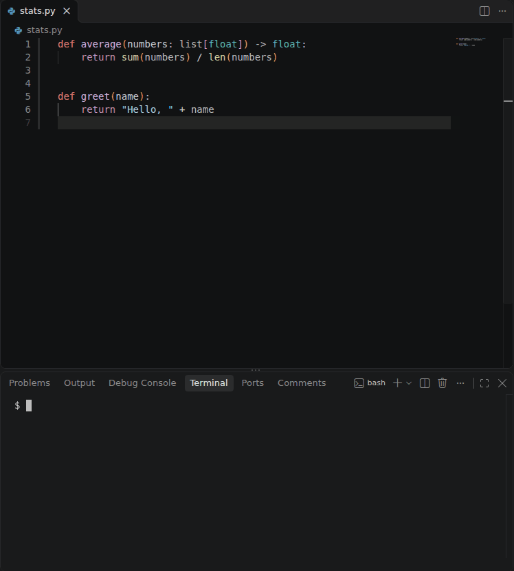
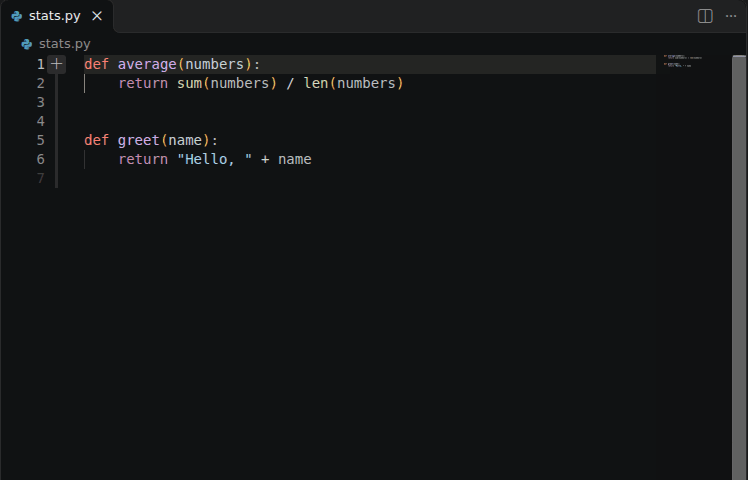

# skills

**Use Claude inside GitHub Copilot.** Copilot's own inline chat (Ctrl+I) and agent mode, answered by Claude
through your Claude Code login: a Claude Pro, Team or Enterprise plan, no API key. Plus a few
[Claude Code skills](https://code.claude.com/docs/en/skills).

| Copilot Ctrl+I on Claude | Copilot Chat agent on Claude |
|---|---|
|  |  |
| **One-step setup (copilot-claude skill)** | **Claude inline box (no Copilot)** |
|  |  |

## Quick start

1. Install [Claude Code](https://code.claude.com) and log in once (`claude`, then `/login`).
2. In Claude Code: `/plugin install helgi-skills --marketplace HelgiHelgasonCMD/skills`
3. Ask Claude Code: *"set up Copilot inline chat with Claude"*. The `copilot-claude` skill installs the
   [claude-inline](vscode/claude-inline/) extension and makes Claude the Ctrl+I model.
4. Reload VS Code and press Ctrl+I. In Copilot Chat, pick **Claude Code → Claude Sonnet / Opus / Haiku**.

You need GitHub Copilot signed in, because the UI is Copilot's, and the Claude Code CLI logged in, because the answers are Claude's.
Ghost-text completions stay on Copilot's models.

## Skills

| Skill | What it does |
|---|---|
| [copilot-claude](skills/copilot-claude/) | Sets up Copilot's Ctrl+I inline chat and Chat/agent mode to run on Claude via your Claude Code login (no API key): installs the extension below and sets the default model. |
| [inline-comments](skills/inline-comments/) | Copilot-style "comment to change": write `@claude <instruction>` in your code, and each one becomes a separate edit you review in the IDE. |

## VS Code extension

[claude-inline](vscode/claude-inline/) registers Claude Code as a VS Code language-model provider, so
Claude Sonnet, Opus and Haiku appear in Copilot's model pickers. Copilot's tools, like read file and edit
file, are passed to Claude and Claude's tool calls go back to Copilot, so edits show up in Copilot's normal
diff with Keep/Undo. Without Copilot, the **Claude: Inline Chat** command gives a similar box of its own.
Download it from [Releases](https://github.com/HelgiHelgasonCMD/skills/releases).

## Install the skills

As a Claude Code plugin (2.1.275+):

```
/plugin install helgi-skills --marketplace HelgiHelgasonCMD/skills
```

Older versions: `/plugin marketplace add HelgiHelgasonCMD/skills`, then `/plugin install helgi-skills@helgi-skills`.

## Developing

```bash
make install      # symlink skills/* into ~/.claude/skills (never overwrites anything it didn't create)
make check        # validate skills, scan for leaks, run unit tests
make vscode-test  # drive a real VS Code under Xvfb (needs npm ci in vscode/claude-inline, python-xlib)
make showcase     # rebuild the inline-comments walkthrough GIF (needs Pillow)
```

## Conventions

- `skills/<name>/SKILL.md` with `name` matching the directory and a `description` that says **when** to use it.
- Detail goes in `references/`, scripts in `scripts/`; keep `SKILL.md` under 500 lines.
- Anything environment-specific (tenants, org names, internal hosts) goes in a gitignored
  `references/*.local.md` that the skill reads if present. The public skill stays generic.
- `tools/scan_sensitive.py` blocks commits containing GUIDs, emails, Azure DevOps org URLs,
  or any term in the local, gitignored `.sensitive-terms.local`.

Enable the pre-commit hook after cloning: `git config core.hooksPath .githooks`.
